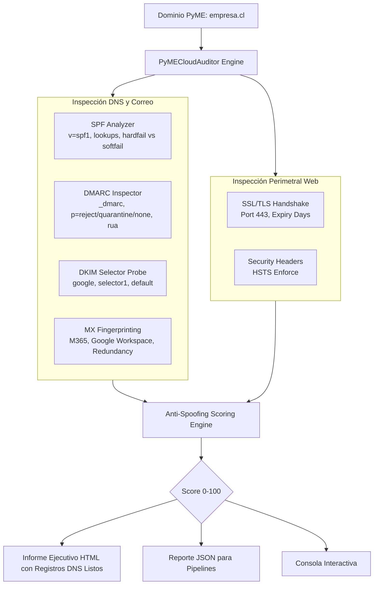

<div align="center">

# ☁️ PyME-Cloud-Posture
### *SME Email & Cloud Security Posture Auditor | SPF, DKIM, DMARC, DNS & Anti-Spoofing Assessment*

[](https://www.python.org/)
[](https://opensource.org/licenses/MIT)
[](https://dmarc.org/)
[]()
[]()

**Auditor automatizado de higiene y configuración de correo corporativo, prevención de suplantación de identidad (Anti-Spoofing) y seguridad perimetral web para Pequeñas y Medianas Empresas.**

[El Problema BEC](#-el-problema-del-fraude-del-ceo-y-bec) • [Capacidades](#-capacidades-de-auditoría) • [Arquitectura](#-arquitectura-del-escaneo) • [Uso](#-ejemplos-de-uso) • [Reportes](#-reporte-ejecutivo) • [Autor](#-autor)

</div>

---

## 🛑 El Problema del Fraude del CEO y BEC

El **Compromiso de Correo Corporativo (BEC)** y la suplantación de identidad representan más del 70% de las pérdidas financieras por ciberataques en PyMEs a nivel global. Los ciberdelincuentes aprovechan que el dominio corporativo carece de configuraciones de autenticación (**SPF, DKIM y DMARC**) para enviar correos haciéndose pasar por los dueños, gerentes o el área de finanzas, solicitando desvíos de transferencias o enviando facturas falsas a clientes reales.

**PyME-Cloud-Posture** evalúa de forma externa y no invasiva cualquier dominio empresarial en segundos, entregando un **Score de Resiliencia Anti-Spoofing (0-100)** y los registros DNS exactos para copiar y pegar en Cloudflare, cPanel, NIC Chile o GoDaddy para cerrar la brecha.

---

## ✨ Capacidades de Auditoría

- 📧 **Sender Policy Framework (SPF - RFC 7208)**:
  - Detección de existencia y sintaxis de registro `v=spf1`.
  - Detección de directivas críticas como `+all` (puerta abierta a cualquier remitente).
  - Evaluación de política estricta (`-all` Hardfail) vs permisiva (`~all` Softfail).
- 🛡️ **DMARC (RFC 7489)**:
  - Auditoría de registro en `_dmarc.<dominio>`.
  - Verificación de directiva de aplicación: `p=reject` (Máxima seguridad), `p=quarantine` (Moderada) o `p=none` (Insegura / Solo monitoreo).
  - Validación de buzón de recepción de reportes agregados forenses (`rua=`).
- 🔑 **DomainKeys Identified Mail (DKIM - RFC 6376)**:
  - Inspección automática de selectores estándar corporativos (`google`, `selector1`, `default`, `k1`, `s1`).
  - Verificación de presencia de claves criptográficas públicas.
- 🏢 **Identificación y Redundancia de Infraestructura de Correo (MX)**:
  - Reconocimiento de proveedores (Microsoft 365, Google Workspace, Zoho Mail, servidores locales).
  - Comprobación de redundancia de servidores MX para evitar pérdida de correos comerciales ante caídas.
- 🔒 **Postura Web y Salud de Certificados SSL/TLS**:
  - Detección de certificados SSL/TLS próximos a vencer (< 21 días) o expirados.
  - Auditoría de cabecera de seguridad **HSTS** (*Strict-Transport-Security*) para mitigar ataques de degradación MITM (SSL Strip).

---

## 🏛️ Arquitectura del Escaneo



---

## 🚀 Instalación Rápida

La herramienta no requiere librerías externas obligatorias; corre con el runtime estándar de Python 3.8+:

```bash
# Clonar repositorio
git clone https://github.com/RolandoPulgar/pyme-cloud-posture.git
cd pyme-cloud-posture

# (Opcional)
pip install -r requirements.txt
```

---

## 💻 Ejemplos de Uso

### 1. Auditar un dominio y generar reporte ejecutivo HTML
```bash
python main.py miempresa.cl
# Genera por defecto: reporte_cloud_posture.html
```

### 2. Guardar reportes en HTML y JSON en una ubicación personalizada
```bash
python main.py cliente-pyme.cl --format all --output informe_cliente.html
```

### 3. Ejecución silenciosa para integración con scripts de prospección
```bash
python main.py dominio.com --format json --output auditoria.json --quiet
```

---

## 📊 Reporte Ejecutivo y Remediación Directa

A diferencia de escáneres genéricos, **PyME-Cloud-Posture** entrega una caja de código con el registro DNS exacto para solucionar el problema:

```text
Registro DNS Sugerido para Copiar/Pegar:
Tipo: TXT | Host: _dmarc | Valor: v=DMARC1; p=quarantine; rua=mailto:seguridad@tudominio.cl; pct=100
```

El informe HTML generado (`examples/sample_report.html`):
1. **Semáforo de Resiliencia Anti-Spoofing** (Calificación y desglose de riesgo).
2. **Impacto en el Negocio**: Explicación clara sin tecnicismos para gerentes de empresa.
3. **Planes de Mitigación y Registros Listos para Implementar**.

---

## 👤 Autor

**Rolando Pulgar**  
Consultoría en Ciberseguridad, Automatización e Infraestructura Segura para PyMEs  
- **GitHub**: [@RolandoPulgar](https://github.com/RolandoPulgar)  
- **Email**: `rpulgar@omenlabs.cl`  

---

## 📄 Licencia

Este proyecto está bajo la Licencia **MIT** - consulta el archivo [LICENSE](LICENSE) para más detalles.
